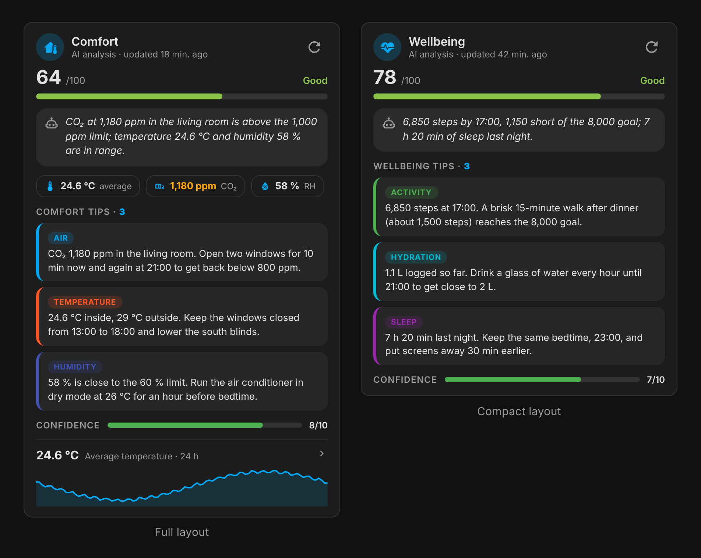

# AI Coach

[](https://hacs.xyz/docs/faq/custom_repositories/)
[](https://github.com/artech-lab/ha-ai-coach/releases)
[](https://github.com/artech-lab/ha-ai-coach/actions/workflows/validate.yml)
[](LICENSE)

[English](README.md) | **Italiano**

Un'integrazione per Home Assistant che trasforma qualunque gruppo di entità in un **coach AI**: secondo una
pianificazione chiede al modello AI che usi già, tramite [AI Task](https://www.home-assistant.io/integrations/ai_task/)
di Home Assistant, un **punteggio**, una breve **sintesi**, fino a cinque **consigli attuabili** e quanto sono
**affidabili** i dati. I risultati sono entità normali, con cronologia e statistiche a lungo termine, e una
card per le plance è inclusa.



<sub>Schermate realizzate con dati dimostrativi.</sub>

## Funzionalità

- **Qualunque argomento**: comfort in casa, energia, benessere, giardino, stampante 3D... Una voce per coach.
- **Scegli i dati** con un elenco di entità e/o un'[etichetta](https://www.home-assistant.io/docs/organizing/labels/):
  nome, area, valore e unità di ogni entità vengono inviati all'AI; i valori offline sono segnalati e
  abbassano solo l'affidabilità.
- **Funziona da sola**: ogni N ore, eventualmente solo in una fascia oraria, e/o a un orario fisso ogni giorno;
  la prima analisi parte subito dopo la configurazione. Un pulsante e un'azione la avviano su richiesta.
- **Il tuo prompt, se vuoi**: istruzioni aggiuntive al prompt standard, oppure un template Jinja completo con
  accesso a ogni stato, per coach costruiti su misura per la tua casa.
- **Entità**: punteggio e affidabilità con statistiche a lungo termine, sintesi, consigli (come attributo
  elenco), ora dell'ultima analisi, analisi in corso, problema nell'analisi, pulsante *Esegui analisi*.
- **Evento** `ai_coach_analysis_completed` dopo ogni analisi, per notifiche e automazioni.
- **Card inclusa**, caricata automaticamente: fascia del punteggio, sintesi, consigli con un'etichetta
  colorata per tema, barra di affidabilità; layout completo con fino a tre statistiche in tempo reale e un
  grafico, oppure compatto.
- **Qualunque fornitore AI** supportato da AI Task (OpenAI, Google Gemini, Anthropic, Ollama e altri), in
  locale o nel cloud. Le risposte seguono la lingua di Home Assistant.
- **Interfaccia in inglese e italiano**; gli ID delle entità sono sempre in inglese.

## Requisiti

- Home Assistant **2025.8** o successivo.
- Un'integrazione AI che fornisce un'entità **AI Task**. Il coach usa quella scelta, oppure la prima che trova.

## Installazione

### HACS (consigliato)

[](https://my.home-assistant.io/redirect/hacs_repository/?owner=artech-lab&repository=ha-ai-coach&category=integration)

1. Premi il pulsante qui sopra, oppure in HACS apri il menu (⋮) > **Repository personalizzati** e aggiungi
   `https://github.com/artech-lab/ha-ai-coach` con tipo **Integrazione**.
2. Scarica **AI Coach** e riavvia Home Assistant.

Da Home Assistant 2026.11 HACS è integrato come **Marketplace**: i passaggi sono gli stessi.

### Manuale

Copia `custom_components/ai_coach` dall'[ultima release](https://github.com/artech-lab/ha-ai-coach/releases/latest)
in `/config/custom_components/ai_coach` e riavvia Home Assistant.

## Configurazione

[](https://my.home-assistant.io/redirect/config_flow_start/?domain=ai_coach)

Impostazioni > Dispositivi e servizi > **Aggiungi integrazione** > **AI Coach**, poi compila:

| Campo | Descrizione |
| --- | --- |
| Nome | Nome del dispositivo e ID delle entità: *Energy* dà `sensor.ai_coach_energy_score` e così via |
| Argomento | Cosa valuta l'AI, per esempio *consumi energetici della casa* |
| Entità da analizzare / Etichetta | I dati: un elenco di entità, tutte le entità e i sensori dei dispositivi con un'etichetta, o entrambi (massimo 60) |
| Istruzioni aggiuntive | Obiettivi, contesto e riferimenti, aggiunti al prompt standard |
| Entità AI Task | Vuoto: la prima trovata |
| Analizza ogni | Ore tra un'analisi e l'altra, `0` = nessuna |
| Solo dalle / Alle | Fascia oraria facoltativa per l'analisi periodica (anche a cavallo della mezzanotte) |
| Anche ogni giorno alle | Analisi giornaliera facoltativa a orario fisso |

Aggiungi una voce per ogni coach. Ogni opzione si cambia poi con **Configura**, dove c'è anche il
**template del prompt**.

### Template del prompt (avanzato)

Lascialo vuoto per usare il prompt standard. Se impostato, sostituisce tutte le istruzioni inviate all'AI e
viene calcolato come template Jinja a ogni analisi, con tutte le funzioni di Home Assistant più queste
variabili:

| Variabile | Contenuto |
| --- | --- |
| `coach_data` | Le entità scelte, una per riga: `- Nome [Area]: valore unità` |
| `topic` | L'argomento |
| `language` | Lingua di Home Assistant in inglese, per esempio `Italian` |
| `instructions` | Le istruzioni aggiuntive |

La risposta è sempre strutturata come `summary`, `score` (5-100), `tips` (3-5) e `confidence` (1-10), quindi
descrivi questi quattro elementi nel prompt. Esempio: [`examples/prompt_template.jinja`](examples/prompt_template.jinja).

## Entità

Per un coach chiamato *Energy*:

| Entità | Descrizione |
| --- | --- |
| `sensor.ai_coach_energy_score` | Punteggio 0-100, con statistiche a lungo termine |
| `sensor.ai_coach_energy_confidence` | Affidabilità 0-10 dei dati, con statistiche a lungo termine |
| `sensor.ai_coach_energy_summary` | Sintesi (primi 255 caratteri); l'attributo `text` contiene la sintesi intera |
| `sensor.ai_coach_energy_tips` | Numero di consigli; l'attributo `tips` contiene l'elenco |
| `sensor.ai_coach_energy_last_analysis` | Ora dell'ultima analisi; attributi `error`, `duration`, `topic` |
| `binary_sensor.ai_coach_energy_analysing` | Acceso mentre l'AI lavora |
| `binary_sensor.ai_coach_energy_problem` | Acceso se l'ultima analisi non è riuscita (il risultato precedente resta) |
| `button.ai_coach_energy_run_analysis` | Esegue subito l'analisi |

L'ultimo risultato viene salvato e ripristinato dopo un riavvio.

## Azioni ed eventi

- `ai_coach.run_analysis` (`config_entry_id`): esegue subito l'analisi e restituisce il risultato.
- `ai_coach.set_result` (`config_entry_id`, `summary`, `score`, `confidence`, `tips`): scrive a mano un risultato,
  per esempio per riportare l'ultima analisi quando si migra dagli helper.
- Evento `ai_coach_analysis_completed` con `config_entry_id`, `name`, `time`, `summary`, `score`, `confidence`,
  `tips`. Esempio di notifica: [`examples/notify_low_score.yaml`](examples/notify_low_score.yaml).

## Card

L'integrazione pubblica e carica la card da sola: nessuna risorsa da aggiungere alla plancia. Modifica una
plancia, aggiungi la card **AI Coach Card** e scegli un coach (un suo sensore qualsiasi), oppure in YAML:

```yaml
type: custom:ai-coach-card
entity: sensor.ai_coach_energy_score
color: amber
icon: mdi:lightning-bolt
```

Il titolo predefinito è il nome del coach; il pulsante aggiorna preme *Esegui analisi*. Aggiungi
`layout: compact` per avere solo punteggio, sintesi e consigli. Il layout completo accetta anche fino a tre
statistiche (`stat1_entity` o `stat1_template`, `stat1_name`, `stat1_icon`, `stat1_decimals`, `stat1_suffix`,
`stat1_warn_above`) e un grafico (`graph_entity`, `graph_name`, `graph_hours`): vedi
[`examples/card.yaml`](examples/card.yaml). Ogni opzione è nell'editor visuale.

I consigli scritti come `Tema: testo` ricevono un'etichetta colorata: *Attività*, *Sonno*, *Idratazione*,
*Alimentazione*, *Recupero*, *Dati*, *Aria*, *Temperatura*, *Umidità*, *Energia*, *Risparmio*, *Luce*,
*Sicurezza* e *Manutenzione* (e i loro nomi inglesi) hanno colori fissi, ogni altro tema riceve un colore
proprio e stabile.

La card funziona anche senza l'integrazione, con le due fonti di prima: helper scritti dalle tue automazioni
(`summary_entity`, `score_entity`, `tip1_entity`... e `update_automation`), oppure l'analisi integrata nel
browser (`entities`, `label`, `topic`), che gira solo con la plancia aperta.

## Se usavi AI Coach Card (Dashboard di HACS)

Questa integrazione sostituisce la card autonoma `artech-lab/ai-coach-card`, non più mantenuta:

1. Rimuovi *AI Coach Card* da HACS (o la sua risorsa della plancia), in modo che venga caricata solo la copia
   inclusa nell'integrazione; la console segnala i duplicati.
2. Crea una voce AI Coach per ogni coach. Per mantenere un prompt messo a punto in un'automazione, incollalo
   nel template del prompt, con le variabili dell'automazione come blocchi ``.
3. Se vuoi riporta l'ultimo risultato con `ai_coach.set_result`, poi collega le card alla nuova entità
   (`entity:`) e disattiva la vecchia automazione e gli helper.

Le configurazioni esistenti della card continuano a funzionare, compresa `custom:ai-coach-lite-card`.

## Privacy

I valori delle entità scelte, e tutto ciò che legge il template del prompt, vengono inviati all'integrazione AI
configurata in Home Assistant: con un fornitore cloud escono dalla tua rete, con un modello locale no. La
diagnostica esclude elenchi di entità, istruzioni e template del prompt.

## Risoluzione dei problemi

- **Sensore problema acceso e nessuna analisi**: non esiste un'entità AI Task; configura
  un'integrazione AI e scegli la sua entità AI Task nelle opzioni.
- **Errore dal modello** (modello non trovato, quota, timeout): guarda l'attributo `error` del sensore
  dell'ultima analisi. I modelli locali possono impiegare un minuto alla prima richiesta.
- **La card mostra "Questo non è un sensore dell'integrazione AI Coach"**: scegli uno dei sensori del coach.
- **Due copie della card**: rimuovi la card autonoma *AI Coach Card* da HACS o da Impostazioni > Plance > Risorse.

## Sviluppo

```bash
python3.13 -m venv .venv && . .venv/bin/activate && pip install -r requirements_test.txt
scripts/check.sh     # ruff, sintassi della card, test della card (node), test dell'integrazione (pytest)
```

La card è un unico modulo ES senza dipendenze, `custom_components/ai_coach/frontend/ai-coach-card.js`. La
versione sta solo in `manifest.json`. Vedi [`CLAUDE.md`](CLAUDE.md) e i comandi di Claude Code `/publish` e
`/release`.

## Avvertenze

I consigli sono generati da un modello AI e possono essere sbagliati. Non sono consulenze professionali: per
salute, sicurezza o lavori elettrici affidati sempre a una persona qualificata.

## Licenza

Copyright © 2026 The ha-ai-coach contributors. Rilasciato sotto la
[GNU General Public License v3.0 o successiva](LICENSE).
