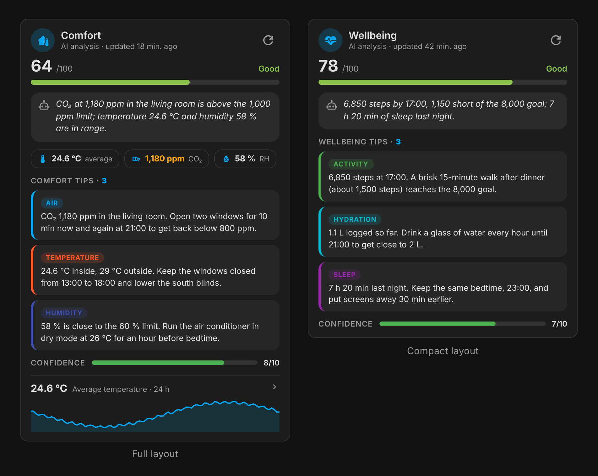

# AI Coach

[](https://hacs.xyz/docs/faq/custom_repositories/)
[](https://github.com/artech-lab/ha-ai-coach/releases)
[](https://github.com/artech-lab/ha-ai-coach/actions/workflows/validate.yml)
[](LICENSE)

**English** | [Italiano](README.it.md)

A Home Assistant integration that turns any group of entities into an **AI coach**: on a schedule it asks the
AI model you already use, through Home Assistant's [AI Task](https://www.home-assistant.io/integrations/ai_task/),
for a **score**, a short **summary**, up to five **actionable tips** and how **reliable** the data are. The
results are regular entities, with history and long-term statistics, and a dashboard card is included.



<sub>Screenshots made with demo data.</sub>

## Features

- **Any topic**: indoor comfort, energy, wellbeing, the garden, a 3D printer... One entry per coach.
- **Pick the data** with an entity list and/or a [label](https://www.home-assistant.io/docs/organizing/labels/):
  name, area, value and unit of every entity are sent to the AI; offline values are marked and only
  lower the confidence.
- **Runs by itself**: every N hours, optionally only inside a time window, and/or at a fixed time each day;
  the first analysis starts right after setup. A button and an action run it on demand.
- **Your prompt, if you want**: extra instructions on top of the standard prompt, or a full Jinja prompt
  template with access to every state, for coaches tuned to your home.
- **Entities**: score and confidence with long-term statistics, summary, tips (as a list attribute),
  time of the last analysis, analysis running, analysis problem, *Run analysis* button.
- **Event** `ai_coach_analysis_completed` after every analysis, for notifications and automations.
- **Bundled card**, loaded automatically: score band, summary, tips with a coloured chip per theme,
  confidence bar; full layout with up to three live statistics and a sparkline, or compact.
- **Any AI provider** supported by AI Task (OpenAI, Google Gemini, Anthropic, Ollama and others), local or
  in the cloud. Answers follow the language of Home Assistant.
- **English and Italian** user interface; entity IDs are always English.

## Requirements

- Home Assistant **2025.8** or newer.
- An AI integration that provides an **AI Task** entity. The coach uses the one you choose, or the first
  one it finds.

## Installation

### HACS (recommended)

[](https://my.home-assistant.io/redirect/hacs_repository/?owner=artech-lab&repository=ha-ai-coach&category=integration)

1. Click the button above, or in HACS open the menu (⋮) > **Custom repositories** and add
   `https://github.com/artech-lab/ha-ai-coach` with type **Integration**.
2. Download **AI Coach** and restart Home Assistant.

From Home Assistant 2026.11, HACS is built in as the **Marketplace**: the steps are the same.

### Manual

Copy `custom_components/ai_coach` from the [latest release](https://github.com/artech-lab/ha-ai-coach/releases/latest)
to `/config/custom_components/ai_coach` and restart Home Assistant.

## Setup

[](https://my.home-assistant.io/redirect/config_flow_start/?domain=ai_coach)

Settings > Devices & services > **Add integration** > **AI Coach**, then fill in:

| Field | Description |
| --- | --- |
| Name | Device name and entity IDs: *Energy* gives `sensor.ai_coach_energy_score` and so on |
| Topic | What the AI evaluates, for example *energy use of the home* |
| Entities to analyse / Label | The data: a list of entities, every entity and device sensor with a label, or both (max 60) |
| Extra instructions | Goals, context and references, added to the standard prompt |
| AI Task entity | Empty: the first one found |
| Analyse every | Hours between analyses, `0` = none |
| Only from / Until | Optional time window for the periodic analysis (also across midnight) |
| Also every day at | Optional fixed daily analysis |

Add one entry per coach. Every option can be changed later with **Configure**, which also has the
**prompt template**.

### Prompt template (advanced)

Leave it empty to use the standard prompt. When set, it replaces the whole instructions sent to the AI and is
rendered as a Jinja template at every analysis, with every Home Assistant function plus these variables:

| Variable | Content |
| --- | --- |
| `coach_data` | The selected entities, one per line: `- Name [Area]: value unit` |
| `topic` | The topic |
| `language` | Language of Home Assistant in English, for example `Italian` |
| `instructions` | The extra instructions |

The answer is always structured as `summary`, `score` (5-100), `tips` (3-5) and `confidence` (1-10), so
describe those four in your prompt. Example: [`examples/prompt_template.jinja`](examples/prompt_template.jinja).

## Entities

For a coach named *Energy*:

| Entity | Description |
| --- | --- |
| `sensor.ai_coach_energy_score` | Score 0-100, with long-term statistics |
| `sensor.ai_coach_energy_confidence` | Confidence 0-10 about the data, with long-term statistics |
| `sensor.ai_coach_energy_summary` | Summary (first 255 characters); attribute `text` holds the whole summary |
| `sensor.ai_coach_energy_tips` | Number of tips; attribute `tips` holds the list |
| `sensor.ai_coach_energy_last_analysis` | Time of the last analysis; attributes `error`, `duration`, `topic` |
| `binary_sensor.ai_coach_energy_analysing` | On while the AI is working |
| `binary_sensor.ai_coach_energy_problem` | On when the last analysis failed (the previous result stays) |
| `button.ai_coach_energy_run_analysis` | Runs the analysis now |

The last result is stored and restored after a restart.

## Actions and events

- `ai_coach.run_analysis` (`config_entry_id`): runs the analysis now and returns the result.
- `ai_coach.set_result` (`config_entry_id`, `summary`, `score`, `confidence`, `tips`): writes a result by hand,
  for example to carry over the last analysis when migrating from helpers.
- Event `ai_coach_analysis_completed` with `config_entry_id`, `name`, `time`, `summary`, `score`, `confidence`,
  `tips`. Example notification: [`examples/notify_low_score.yaml`](examples/notify_low_score.yaml).

## Card

The integration serves and loads the card by itself: no dashboard resource to add. Edit a dashboard, add the
card **AI Coach Card** and pick a coach (any of its sensors), or in YAML:

```yaml
type: custom:ai-coach-card
entity: sensor.ai_coach_energy_score
color: amber
icon: mdi:lightning-bolt
```

The title defaults to the coach name; the refresh button presses *Run analysis*. Add `layout: compact` for
score, summary and tips only. The full layout also takes up to three statistics (`stat1_entity` or
`stat1_template`, `stat1_name`, `stat1_icon`, `stat1_decimals`, `stat1_suffix`, `stat1_warn_above`) and a
sparkline (`graph_entity`, `graph_name`, `graph_hours`): see [`examples/card.yaml`](examples/card.yaml).
Every option is in the visual editor.

Tips written as `Theme: text` get a coloured chip: *Activity*, *Sleep*, *Hydration*, *Nutrition*, *Recovery*,
*Data*, *Air*, *Temperature*, *Humidity*, *Energy*, *Savings*, *Light*, *Security* and *Maintenance* (and
their Italian names) have fixed colours, any other theme gets a stable colour of its own.

The card still works without the integration, with its two former sources: helpers written by your own
automations (`summary_entity`, `score_entity`, `tip1_entity`... and `update_automation`), or its built-in
browser analysis (`entities`, `label`, `topic`), which runs only while the dashboard is open.

## Coming from AI Coach Card (HACS Dashboard)

This integration replaces the standalone card `artech-lab/ai-coach-card`, which is no longer maintained:

1. Remove *AI Coach Card* from HACS (or its dashboard resource), so that only the copy bundled with the
   integration is loaded; the console warns about duplicates.
2. Create one AI Coach entry per coach. To keep a prompt you tuned in an automation, paste it into the prompt
   template, with the automation variables as `` blocks.
3. Optionally carry over the last result with `ai_coach.set_result`, then point the cards to the new entity
   (`entity:`) and disable the old automation and helpers.

Existing card configurations keep working unchanged, `custom:ai-coach-lite-card` included.

## Privacy

The values of the chosen entities, and whatever your prompt template reads, are sent to the AI integration
configured in Home Assistant: with a cloud provider they leave your network, with a local model they do not.
Diagnostics leave out entity lists, instructions and prompt templates.

## Troubleshooting

- **Problem sensor on and no analysis**: there is no AI Task entity; set up an AI integration
  and pick its AI Task entity in the options.
- **Error from the model** (model not found, quota, timeout): see the `error` attribute of the last analysis
  sensor. Local models can take a minute on the first request.
- **The card shows "This is not a sensor of the AI Coach integration"**: choose one of the coach sensors.
- **Two copies of the card**: remove the standalone *AI Coach Card* from HACS or from Settings > Dashboards >
  Resources.

## Development

```bash
python3.13 -m venv .venv && . .venv/bin/activate && pip install -r requirements_test.txt
scripts/check.sh     # ruff, card syntax, card unit tests (node), integration tests (pytest)
```

The card is a single dependency-free ES module, `custom_components/ai_coach/frontend/ai-coach-card.js`. The
version lives only in `manifest.json`. See [`CLAUDE.md`](CLAUDE.md) and the Claude Code commands `/publish`
and `/release`.

## Disclaimer

The tips are generated by an AI model and can be wrong. They are not professional advice: for health, safety
or electrical work always rely on a qualified person.

## License

Copyright © 2026 The ha-ai-coach contributors. Released under the
[GNU General Public License v3.0 or later](LICENSE).
